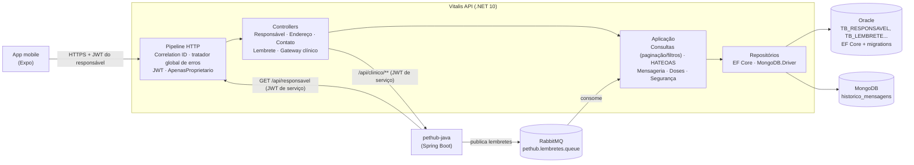
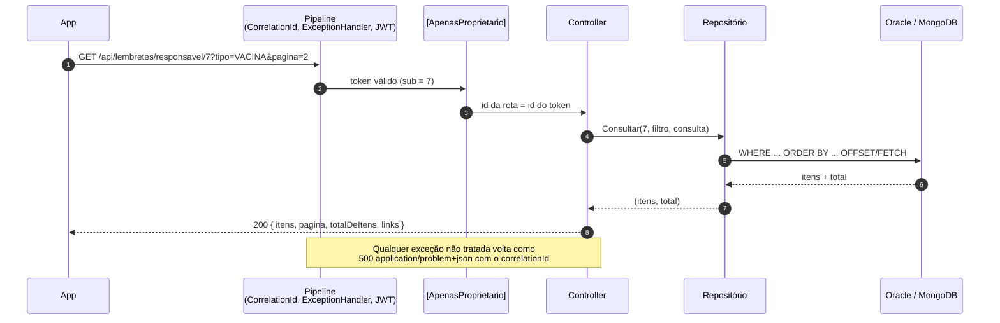
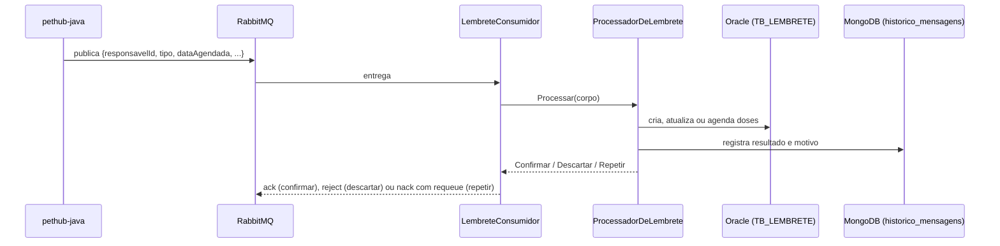

# Vitalis API

API RESTful desenvolvida em **ASP.NET Core (.NET 10)** responsável pelo domínio do **Responsável** no sistema PetHub.

O PetHub é um sistema veterinário composto por **dois serviços**. Cada um é dono das próprias tabelas
(podem usar o mesmo schema Oracle ou bancos separados) e nenhum acessa o banco do outro:

| Serviço | Tecnologia | Responsabilidade |
|---|---|---|
| **Vitalis (este)** | C# .NET 10 | Cadastro e login do **responsável**, endereços, contatos, **lembretes** e o gateway do responsável para o serviço clínico |
| **pethub-java** | Java 21 + Spring Boot | Veterinários, pets, consultas, prontuário, exames, e-mail de confirmação e IA (Gemini) |

Como conversam:

| Fluxo | Direção | Como |
|---|---|---|
| Lembrete (consulta marcada, vacina, exame, medicamento) | Java → **RabbitMQ** → Vitalis | O Java só publica; **só o Vitalis consome** (`Mensageria/LembreteConsumidor`) |
| Responsável usa pets, consultas, exames... | App → Vitalis `/api/clinico/**` → Java | O Vitalis valida o JWT e repassa ao Java com um JWT de serviço HS256 de 60 s (`X-Service-Authorization`, `sub` = responsável); o Java aplica as regras de posse |
| Java precisa do nome/e-mail/CPF do responsável | Java → Vitalis | `GET /api/responsavel/{id}` e `/buscar?cpf=` com JWT de serviço assinado pelo Java |
| Responsável é excluído | Vitalis → Java | `DELETE /api/pets/responsavel/{id}` **antes** de apagar o cadastro; se o Java não confirmar, nada é apagado |

O veterinário não passa por aqui: ele faz login direto no Java.

**Evolução por sprint:** a 3ª sprint trouxe monitoramento e observabilidade (Health Checks, Serilog e OpenTelemetry)
e a suíte de testes no padrão AAA. A **4ª sprint** consolida tudo e acrescenta: **MongoDB** para o histórico de
mensagens da fila, **migrations do EF Core**, **paginação, ordenação e filtros**, **HATEOAS**, **tratamento global
de exceções** com respostas de erro num formato único (`application/problem+json`) e o **OpenAPI exportado**
em [`docs/openapi.json`](docs/openapi.json).

---

## Sumário

- [Tecnologias](#tecnologias)
- [Arquitetura](#arquitetura)
- [Instalação e execução](#instalação-e-execução)
- [Persistência: Oracle (relacional) e MongoDB (NoSQL)](#persistência-oracle-relacional-e-mongodb-nosql)
- [Paginação, ordenação, filtros e HATEOAS](#paginação-ordenação-filtros-e-hateoas)
- [Tratamento de erros](#tratamento-de-erros)
- [Monitoramento e observabilidade](#monitoramento-e-observabilidade)
- [Configuração](#configuração)
- [Testes automatizados](#testes-automatizados)
- [Documentação das rotas](#documentação-das-rotas)
- [Lembretes pela fila (RabbitMQ)](#lembretes-pela-fila-rabbitmq)
- [Senhas e segurança](#senhas-e-segurança)
- [Integrantes](#integrantes)

---

## Tecnologias

**Aplicação**

- .NET 10 / ASP.NET Core Web API
- Entity Framework Core 10 + Oracle.EntityFrameworkCore, com **migrations**
- **MongoDB.Driver 3** — histórico de mensagens da fila (NoSQL)
- BCrypt.Net-Next (hash de senhas)
- JWT (`Microsoft.AspNetCore.Authentication.JwtBearer`) — autenticação do responsável
- RabbitMQ.Client 7 — consumo da fila de lembretes (CloudAMQP)
- Swashbuckle (Swagger / OpenAPI 3.0), com os comentários XML dos controllers

**Monitoramento e observabilidade**

- `Microsoft.Extensions.Diagnostics.HealthChecks` — verificações de saúde da API
- **Serilog** (`Serilog.AspNetCore`, `Serilog.Sinks.Console`, `Serilog.Sinks.File`) — logging estruturado
- **OpenTelemetry** (`Extensions.Hosting`, `Instrumentation.AspNetCore`, `Instrumentation.Http`, `Exporter.Console`, `Exporter.OpenTelemetryProtocol`) — tracing distribuído e métricas

**Testes**

- **xUnit** — framework de testes
- **Moq** — mocking de dependências
- **FluentAssertions** — asserções expressivas
- `Microsoft.AspNetCore.Mvc.Testing` (`WebApplicationFactory`) — testes de integração
- `Microsoft.EntityFrameworkCore.InMemory` — banco em memória nos testes de integração
- **coverlet** — cobertura de código

---

## Arquitetura

### Visão da solução



### Camadas

A API é um único projeto organizado em camadas por pasta. A dependência vai sempre de cima para baixo: controllers
não falam com o banco, e repositórios não conhecem HTTP.

| Camada | Pastas | Responsabilidade |
|---|---|---|
| **Apresentação (HTTP)** | `Controllers/`, `Middlewares/`, `Erros/`, `Dto/` | Rotas REST, validação de entrada, respostas com HATEOAS, `ProblemDetails` |
| **Aplicação** | `Consultas/`, `Hateoas/`, `Mensageria/`, `Doses/`, `Seguranca/` | Paginação/filtros, montagem de links, processamento das mensagens da fila, agenda de doses, JWT e posse dos dados |
| **Domínio** | `Models/` | Entidades `Responsavel`, `ResponsavelEndereco`, `ResponsavelContato`, `Lembrete` e enums |
| **Infraestrutura** | `Repositories/`, `Historico/`, `Dados/`, `Migrations/`, `Integracao/`, `Health/` | EF Core + Oracle, MongoDB, cliente HTTP do Java, health checks |
| **Transversal** | `Configuracao/`, `Observabilidade/`, `Program.cs` | Options, relógio, métricas/tracing, composição da injeção de dependência |

Todas as dependências são registradas por interface em `Program.cs` (`IResponsavelRepository`,
`IHistoricoDeMensagens`, `IPethubJavaClient`, `IEmissorDeToken`, `IAutenticadorDeServico`, `IProcessadorDeLembrete`...),
o que permite trocá-las nos testes por mocks (unitários) ou por versões em memória (integração).

### Caminho de uma requisição



### Caminho de uma mensagem da fila



---

## Instalação e execução

### Pré-requisitos

- [.NET 10 SDK](https://dotnet.microsoft.com/download)
- Oracle (FIAP, ou local em contêiner)
- MongoDB (opcional: sem ele o histórico de mensagens fica desligado)
- `dotnet-ef`, para criar e aplicar migrations pela linha de comando:

```bash
dotnet tool install --global dotnet-ef
export PATH="$PATH:$HOME/.dotnet/tools"
```

### Passo a passo

```bash
# 1. Clonar o repositório
git clone https://github.com/vitalis-sa/PetHub-.NET.git
cd PetHub-.NET

# 2. (Opcional) Bancos locais em contêiner
docker run -d --name vitalis-oracle -p 1521:1521 \
  -e ORACLE_PASSWORD=troque -e APP_USER=vitalis -e APP_USER_PASSWORD=vitalis \
  gvenzl/oracle-free:23-slim-faststart
docker run -d --name vitalis-mongo -p 27017:27017 mongo:7

# 3. Variáveis de ambiente: copie o exemplo e preencha
cp .env.example .env
set -a && . ./.env && set +a

# 4. Restaurar e rodar (as migrations são aplicadas na subida)
dotnet restore
dotnet run
```

A API sobe em `http://localhost:5192` e o Swagger fica em `http://localhost:5192/swagger`
(botão **Authorize**: cole o `token` devolvido por `/api/responsavel/login`).

No devcontainer (`.devcontainer/`), o `.env` já é carregado automaticamente.

### Migrations

As tabelas do Vitalis são criadas e evoluídas pelas **migrations do EF Core** (pasta `Migrations/`). Elas são
aplicadas automaticamente na subida (`Dados/InicializadorDoBanco.cs`) e também podem ser aplicadas pela linha de comando:

```bash
# Aplicar as migrations pendentes no banco de ConnectionStrings__OracleConnection
dotnet ef database update

# Criar uma migration depois de mudar o modelo
dotnet ef migrations add NomeDaMudanca

# Gerar o SQL (para revisão ou para um DBA aplicar)
dotnet ef migrations script --idempotent -o migracoes.sql
```

- As migrations só criam e alteram as tabelas do Vitalis (`TB_RESPONSAVEL`, `TB_RESPONSAVEL_ENDERECO`,
  `TB_RESPONSAVEL_CONTATO`, `TB_LEMBRETE`) e a `__EFMigrationsHistory`. As tabelas do pethub-java, no mesmo schema,
  não são tocadas, então **a ordem de subida dos dois serviços não importa**.
- **Bancos criados antes das migrations** (pelo antigo `CreateTables()`) já têm as tabelas, mas não têm o histórico.
  Na primeira subida, o Vitalis acrescenta a coluna `DATA_HORA` se ela faltar e registra a migration inicial como
  aplicada (*baseline*), sem recriar nada e sem perder dados.
- `Dados/AppDbContextFactory.cs` permite que o `dotnet ef` monte o contexto sem subir a API inteira.
- Para desligar a aplicação automática: `Banco__AplicarMigracoes=false`.

---

## Persistência: Oracle (relacional) e MongoDB (NoSQL)

| | Oracle | MongoDB |
|---|---|---|
| **O que guarda** | Responsáveis, endereços, contatos e lembretes | Histórico de cada mensagem recebida da fila e do que foi feito com ela |
| **Por quê** | Dados com relacionamentos, integridade (FK) e consultas por filtro | Registro de eventos, só de inserção e com formato livre: guarda até mensagens inválidas, como vieram |
| **Acesso** | EF Core, `Repositories/*Repository.cs` | MongoDB.Driver, `Historico/HistoricoDeMensagensMongo.cs` |
| **Esquema** | Migrations (`Migrations/`) | Coleção `historico_mensagens` + índice `ix_responsavel_recebida` criado na subida |
| **Se estiver fora** | `/health` Unhealthy (503) | API funciona; o histórico fica desligado e o `/health` mostra `mongodb` como Degraded |

Os repositórios seguem o padrão **Repository**: os controllers dependem de interfaces (`IResponsavelRepository`,
`ILembreteRepository`, `IHistoricoDeMensagens`...) e as implementações concretas ficam na infraestrutura.

Documento da coleção `historico_mensagens`:

```json
{
  "_id": "6ae49d9027659fdec1c336ed",
  "recebidaEm": "2026-10-30T13:37:20.199Z",
  "responsavelId": 1,
  "petId": 5,
  "tipo": "VACINA",
  "referenciaTipo": "VacinaTratamento",
  "referenciaId": 200,
  "resultado": "Confirmar",
  "motivo": "lembrete criado",
  "corpo": "{\"responsavelId\":1,\"petId\":5,\"tipo\":\"VACINA\", ...}"
}
```

`resultado` é o que foi respondido à fila (`Confirmar`, `Descartar` ou `Repetir`) e `motivo` diz por quê
(`lembrete criado`, `lembrete atualizado`, `4 dose(s) agendada(s)`, `responsável inexistente`, `mensagem inválida`...).
Se o MongoDB falhar, a mensagem segue normalmente: o histórico é auditoria e nunca devolve à fila um lembrete que
já foi gravado no Oracle.

O responsável consulta o próprio histórico em `GET /api/lembretes/responsavel/{id}/historico` (paginado e com
filtros, veja abaixo). O campo `corpo` fica só no banco, para auditoria.

---

## Paginação, ordenação, filtros e HATEOAS

### Parâmetros

Toda listagem aceita os mesmos parâmetros de paginação e ordenação, mais filtros próprios:

| Parâmetro | Padrão | Regra |
|---|---|---|
| `pagina` | `1` | de 1 a 100.000 |
| `tamanho` | `10` | de 1 a 100 |
| `ordenarPor` | depende do recurso | só os campos listados abaixo (outro valor → `400`) |
| `direcao` | depende do recurso | `asc` ou `desc` |

| Listagem | Filtros | `ordenarPor` (padrão em negrito) |
|---|---|---|
| `GET /api/responsavel/{id}/enderecos` | `cidade` (parte do nome, sem diferenciar maiúsculas), `estado`, `principal` | **`id`** ↑, `cidade`, `estado`, `bairro`, `logradouro` |
| `GET /api/responsavel/{id}/contatos` | `tipo`, `principal` | **`id`** ↑, `tipo`, `telefone` |
| `GET /api/lembretes/responsavel/{id}` | `tipo`, `status`, `petId`, `de` e `ate` (data agendada, `yyyy-MM-dd`) | **`dataAgendada`** ↓, `tipo`, `status`, `id` |
| `GET /api/lembretes/responsavel/{id}/historico` | `resultado`, `tipo`, `de` e `ate` (UTC) | **`recebidaEm`** ↓, `resultado`, `tipo` |

```bash
# 2ª página de 5 lembretes de vacina do pet 3, a partir de novembro, mais antigos primeiro
curl -H "Authorization: Bearer $TOKEN" \
  "http://localhost:5192/api/lembretes/responsavel/1?tipo=VACINA&petId=3&de=2026-11-01&ordenarPor=dataAgendada&direcao=asc&pagina=2&tamanho=5"
```

### Resposta paginada com HATEOAS

Toda listagem devolve o mesmo envelope, e cada item traz os links das ações que se aplicam a ele. Os links da página
mantêm os filtros e a ordenação da consulta. Exemplo real de
`GET /api/responsavel/1/enderecos?tamanho=2&ordenarPor=cidade` (um item mostrado):

```json
{
  "itens": [
    {
      "id": 2, "responsavelId": 1, "logradouro": "Rua X", "numero": "1", "complemento": null,
      "bairro": "Cambuí", "cidade": "Campinas", "estado": "SP", "cep": "01310100", "principal": false,
      "links": [
        { "href": "/api/responsavel/1/enderecos/2",           "rel": "self",              "metodo": "GET" },
        { "href": "/api/responsavel/1/enderecos/2",           "rel": "atualizar",         "metodo": "PUT" },
        { "href": "/api/responsavel/1/enderecos/2",           "rel": "excluir",           "metodo": "DELETE" },
        { "href": "/api/responsavel/1/enderecos/2/principal", "rel": "definir-principal", "metodo": "PATCH" },
        { "href": "/api/responsavel/1",                       "rel": "responsavel",       "metodo": "GET" }
      ]
    }
  ],
  "pagina": 1,
  "tamanho": 2,
  "totalDeItens": 3,
  "totalDePaginas": 2,
  "links": [
    { "href": "/api/responsavel/1/enderecos?pagina=1&tamanho=2&ordenarPor=cidade", "rel": "self",  "metodo": "GET" },
    { "href": "/api/responsavel/1/enderecos?pagina=1&tamanho=2&ordenarPor=cidade", "rel": "first", "metodo": "GET" },
    { "href": "/api/responsavel/1/enderecos?pagina=2&tamanho=2&ordenarPor=cidade", "rel": "next",  "metodo": "GET" },
    { "href": "/api/responsavel/1/enderecos?pagina=2&tamanho=2&ordenarPor=cidade", "rel": "last",  "metodo": "GET" }
  ]
}
```

| Recurso | Links |
|---|---|
| Responsável (`GET /api/responsavel/{id}`) | `self`, `atualizar`, `excluir`, `enderecos`, `contatos`, `lembretes`, `historico` |
| Endereço e contato | `self`, `atualizar`, `excluir`, `definir-principal`, `responsavel` |
| Lembrete | `self` (`GET /api/lembretes/{id}`), `atualizar-status`, `excluir`, `responsavel` |
| Registro do histórico | `lembretes`, `responsavel` |
| Página | `self`, `first`, `last` e, quando existirem, `prev` e `next` |

> **Para o app:** as listagens de endereços, contatos e lembretes devolviam um array e agora devolvem o envelope
> acima. Leia a lista em `itens`. Os campos de cada item continuam os mesmos, só ganharam `links`. A rota
> `doses-futuras` continua devolvendo um array.

---

## Tratamento de erros

Todo erro da API sai no mesmo formato, **`application/problem+json`** (RFC 9457), venha de onde vier:

| Origem | Exemplo | Quem monta |
|---|---|---|
| Regra do controller | `404` endereço de outro responsável, `409` CPF duplicado | `Erros/Problemas.cs` |
| Validação automática do `[ApiController]` | `400` JSON malformado, `tamanho=500` | `ProblemDetailsFactory` + `CustomizeProblemDetails` |
| Pipeline sem corpo | `401` sem token, `403`, rota inexistente | `UseStatusCodePages` |
| Exceção não tratada | `500` (genérico), `503` serviço clínico fora | `Erros/TratadorGlobalDeExcecoes.cs` (`IExceptionHandler`) |

Exemplo real (`GET /api/responsavel/1/enderecos/999` com `X-Correlation-ID: aula-42`):

```json
{
  "type": "https://tools.ietf.org/html/rfc9110#section-15.5.5",
  "title": "Not Found",
  "status": 404,
  "detail": "Endereço não encontrado",
  "instance": "/api/responsavel/1/enderecos/999",
  "traceId": "00-cc31419d6fcb5a95624f31831e6871e7-1beb9be53082c18c-01",
  "correlationId": "aula-42",
  "erro": "Endereço não encontrado"
}
```

- `correlationId` é o mesmo do cabeçalho `X-Correlation-ID` e dos logs daquela requisição, e `traceId` é o do
  OpenTelemetry. Com qualquer um dos dois dá para achar o erro no log.
- Erros de validação trazem `errors` campo a campo (`{ "errors": { "ordenarPor": ["Ordene por um destes campos: ..."] } }`).
- O campo `erro` repete o `detail` para manter compatível o app, que lê esse nome desde as primeiras sprints.
- Numa exceção não tratada, o cliente recebe só uma mensagem genérica. A exceção completa vai para o log com
  `LogError`, junto com o mesmo `correlationId`.

---

## Monitoramento e observabilidade

### Health Checks

A API expõe o endpoint nativo de diagnóstico em **`GET /health`**, construído sobre
`Microsoft.Extensions.Diagnostics.HealthChecks`. Ele agrega três verificações customizadas que implementam
a interface `IHealthCheck`:

| Verificação | O que faz | Resultado |
|---|---|---|
| `banco_dados` | Testa a conexão com o Oracle através do `AppDbContext` e mede a latência | `Healthy` ou `Unhealthy`, sempre com `LatenciaMs` |
| `mongodb` | Envia `ping` ao MongoDB e mede a latência | `Healthy` ou `Unhealthy`; `Degraded` quando o Mongo não está configurado |
| `servico_externo` | Faz um `GET` HTTP no backend Java (`ServicosExternos:PethubJava`) | `Healthy` ou `Unhealthy`, com `LatenciaMs` e `StatusCode` |

O status agregado define o código HTTP:

| Status geral | Campo `status` | HTTP |
|---|---|---|
| Todas as verificações saudáveis | `Healthy` | `200 OK` |
| Alguma degradada e nenhuma com falha | `Degraded` | `200 OK` |
| Qualquer verificação com falha | `Unhealthy` | `503 Service Unavailable` |

O corpo é escrito em **JSON** por um `ResponseWriter` customizado (`Health/RespostaHealthCheck.cs`), que detalha
**cada verificação**:

| Campo | Conteúdo |
|---|---|
| `status` | Status agregado da API |
| `duracaoTotalMs` | Tempo total gasto no conjunto de verificações |
| `verificadoEm` | Instante (UTC) da coleta |
| `verificacoes[].nome` | Nome registrado no `AddCheck<>` |
| `verificacoes[].status` | `Healthy`, `Degraded` ou `Unhealthy` |
| `verificacoes[].descricao` | Mensagem devolvida pelo `IHealthCheck` |
| `verificacoes[].duracaoMs` | Duração daquela verificação isolada |
| `verificacoes[].dados` | Dados coletados pelo check (`LatenciaMs`, `StatusCode`, `Banco`) |
| `verificacoes[].erro` | Mensagem da exceção, quando a verificação falha |

```bash
curl -s http://localhost:5192/health | jq                                   # corpo completo
curl -s http://localhost:5192/health | jq -r .status                        # só o status
curl -o /dev/null -w "%{http_code}\n" http://localhost:5192/health          # só o HTTP (orquestradores)
```

Saída real com Oracle e MongoDB no ar e o backend Java fora:

```json
{
  "status": "Unhealthy",
  "duracaoTotalMs": 12.65,
  "verificadoEm": "2026-10-30T13:41:50.2485555+00:00",
  "verificacoes": [
    { "nome": "banco_dados", "status": "Healthy", "descricao": "Conexão com o Banco de Dados estabelecida com sucesso.",
      "duracaoMs": 10.86, "dados": { "LatenciaMs": 10 } },
    { "nome": "mongodb", "status": "Healthy", "descricao": "Conexão com o MongoDB estabelecida com sucesso.",
      "duracaoMs": 6.16, "dados": { "LatenciaMs": 6, "Banco": "vitalis" } },
    { "nome": "servico_externo", "status": "Unhealthy", "descricao": "Serviço externo (pethub-java) inacessível.",
      "duracaoMs": 8.29, "dados": { "LatenciaMs": 7 }, "erro": "Connection refused (localhost:9)" }
  ]
}
```

> Para simular uma falha em sala, basta apontar a `OracleConnection` para um host inexistente, parar o MongoDB
> ou parar o backend Java.

### Logging estruturado (Serilog)

O Serilog substitui o provedor de logging padrão da Microsoft (`builder.Host.UseSerilog()`) e grava em dois
**Sinks** simultâneos:

| Sink | Destino |
|---|---|
| Console | Template `[{Timestamp:HH:mm:ss} {Level:u3}] [{CorrelationId}] {Message:lj}` |
| Arquivo | `logs/vitalis-YYYYMMDD.log`, com rotação diária |

**Níveis de log:**

| Nível | Quando |
|---|---|
| `Information` | Início das consultas, cadastros e atualizações bem-sucedidas, migrations aplicadas, mensagens processadas |
| `Warning` | Recurso não encontrado, credenciais inválidas, token de serviço inválido, mensagem descartada, MongoDB indisponível |
| `Error` | Exceções não tratadas (`TratadorGlobalDeExcecoes`), falha inesperada no cadastro, falha ao gravar lembrete da fila, Java sem confirmar a exclusão dos pets, falha nas migrations. Sempre com `_logger.LogError(ex, ...)` e a exceção completa |

**Correlation ID:** o `CorrelationIdMiddleware` lê o header `X-Correlation-ID` da requisição (ou gera um novo GUID),
devolve o valor no header da resposta e o injeta no `LogContext` do Serilog. Assim **todos os logs daquela requisição
carregam o mesmo identificador**, que também aparece no corpo de qualquer erro.

```bash
curl -i -H "X-Correlation-ID: aula-42" http://localhost:5192/health
```

### Tracing distribuído e métricas (OpenTelemetry)

O OpenTelemetry é registrado em `Program.cs` com o nome de serviço `Vitalis.API` e exporta tudo no **Console**
(`AddConsoleExporter`), permitindo inspecionar traces e métricas diretamente no terminal do Kestrel.

**Tracing**, com auto-instrumentação e spans manuais:

| Fonte | O que rastreia |
|---|---|
| `AddAspNetCoreInstrumentation()` | Requisições HTTP recebidas pela API |
| `AddHttpClientInstrumentation()` | Chamadas HTTP de saída (gateway clínico, verificação do serviço externo) |
| `AddSource("Vitalis.API")` | Spans manuais criados com o `ActivitySource` da aplicação |

O cadastro de responsável abre um span próprio via `ActivitySource` e anexa tags de negócio. Em caso de falha, o
span é marcado com `ActivityStatusCode.Error`.

**Métricas**, centralizadas pela classe `AplicacaoMetricas` no `Meter` da aplicação:

| Métrica | Tipo | Descrição |
|---|---|---|
| `responsaveis_cadastrados_total` | Counter | Responsáveis cadastrados, com a tag `status` |
| `lembretes_criados_total` | Counter | Lembretes gravados a partir da fila, com a tag `status` |

A tag `status` distingue os desfechos (`sucesso`, `erro_validacao`, `erro_cpf_duplicado`, `erro_interno`), o que
permite acompanhar a **taxa de erros** por operação de negócio. O **tempo de resposta** de todas as rotas vem do
histograma `http.server.request.duration`, publicado pela auto-instrumentação do ASP.NET Core.

O pacote `OpenTelemetry.Exporter.OpenTelemetryProtocol` também está instalado: basta trocar `AddConsoleExporter()`
por `AddOtlpExporter()` para enviar os dados a um coletor externo (Jaeger, Prometheus, Grafana ou Aspire Dashboard).

---

## Configuração

**Segredos e endereços vêm de variáveis de ambiente**, nunca do código. No `appsettings.json` ficam só valores vazios
ou de exemplo. O arquivo [`.env.example`](.env.example) traz todas as variáveis, já com os nomes que a API lê.

| Variável | Para quê | Obrigatória |
|---|---|---|
| `ConnectionStrings__OracleConnection` | Conexão Oracle | sim |
| `Jwt__Segredo` | Chave de assinatura do token do responsável (mín. 32 bytes). A API não sobe sem ela | sim |
| `ServicoAuth__Segredo` | Segredo (mín. 32 caracteres) do JWT de serviço entre o Vitalis e o Java. **Mesmo valor do `SERVICE_JWT_SECRET` do Java.** Vazio = nada é emitido nem aceito | sim |
| `Jwt__Emissor`, `Jwt__Audiencia`, `Jwt__ExpiracaoMinutos` | Emissor (padrão `vitalis`), audiência (padrão `vitalis-app`) e validade (padrão 120 min) | não |
| `Mongo__ConnectionString` | Conexão MongoDB. Vazio = histórico desligado | não |
| `Mongo__Banco`, `Mongo__ColecaoHistorico`, `Mongo__TimeoutSegundos` | Banco (padrão `vitalis`), coleção (padrão `historico_mensagens`) e espera máxima por um servidor (padrão 5 s) | não |
| `RabbitMq__Host`, `__Porta`, `__Usuario`, `__Senha`, `__VirtualHost`, `__Ssl` | Broker. No CloudAMQP: porta `5671`, `Ssl=true`, vhost = usuário. Sem `Host`, o consumidor fica desligado | sim, para lembretes |
| `PethubJava__UrlBase` | URL do serviço Java (padrão `http://localhost:8080`) | sim |
| `ServicosExternos__PethubJava` | URL sondada pelo health check (padrão: `/api-docs` do Java) | não |
| `Banco__AplicarMigracoes` | Aplica as migrations na subida (padrão `true`; `Banco__CriarTabelas` ainda é aceito) | não |

- **Fila:** `RabbitMq__Exchange`, `__RoutingKey` e `__Fila` já vêm com os mesmos valores do Java
  (`pethub.lembretes.exchange`, `lembrete.criar`, `pethub.lembretes.queue`). O Vitalis também declara exchange, fila e
  ligação (idempotente), então a mensagem não se perde se o Java publicar antes do Vitalis subir.
- **Cloud Run (padrão, sem instância mínima):** o consumidor só esvazia a fila enquanto a instância estiver acordada.
  Os lembretes ficam guardados na fila durável e são gravados na próxima vez que o serviço subir.
- **Desenvolvimento:** além do `.env`, valem os *user-secrets* (`dotnet user-secrets set "RabbitMq:Senha" "..."`) e
  o arquivo opcional `appsettings.Local.json`, ignorado pelo git.

---

## Testes automatizados

A solução tem **220 testes**, organizados em dois projetos:

| Projeto | Testes | Escopo |
|---|---|---|
| `tests/Vitalis.Tests.Unit` | 146 | Domínio, Aplicação, Mensageria e Segurança, com dependências isoladas por Moq |
| `tests/Vitalis.Tests.Integration` | 74 | Fluxo HTTP completo via `WebApplicationFactory` |

### Cobertura

Medida com coverlet (`dotnet test --collect:"XPlat Code Coverage"`), somando os dois projetos:

| Camada | Cobertura de linhas |
|---|---|
| **Domínio** (`Models/`) | **97,4%** |
| **Aplicação** (`Controllers/`, `Consultas/`, `Hateoas/`, `Erros/`, `Dto/`, `Mensageria/`, `Doses/`, `Seguranca/`) | **91,4%** |
| Total do projeto, sem as migrations geradas | 78,5% |

O ponto menos coberto é a infraestrutura que depende de servidores reais (cliente HTTP do Java e implementação Mongo
do histórico). Nos testes de integração, o MongoDB é substituído por `HistoricoEmMemoria`, com o mesmo filtro, ordem
e paginação. A implementação real foi validada contra um MongoDB 7 e um Oracle 23 em contêiner.

### Como executar

```bash
dotnet test                                         # todos
dotnet test tests/Vitalis.Tests.Unit                # só unitários
dotnet test tests/Vitalis.Tests.Integration         # só integração
dotnet test --collect:"XPlat Code Coverage"         # com cobertura (coverage.cobertura.xml em TestResults/)
dotnet test --logger "console;verbosity=detailed"   # nome de cada teste
dotnet test --filter FullyQualifiedName~ConsultasEHateoasEndpointsTests
```

No Visual Studio: **Teste → Gerenciador de Testes** (`Ctrl + E, T`) e **Executar Todos os Testes**.

Os testes **não dependem de Oracle, MongoDB, RabbitMQ nem do Java**: os unitários usam mocks, e os de integração
usam banco em memória, `HistoricoEmMemoria` e `JavaFalso`.

Para visualizar a cobertura em HTML:

```bash
dotnet tool install --global dotnet-reportgenerator-globaltool
reportgenerator -reports:"**/coverage.cobertura.xml" -targetdir:"coveragereport" -reporttypes:Html
```

### Padrão AAA e nomenclatura

Todos os testes seguem o padrão **AAA (Arrange, Act, Assert)**, com as três etapas comentadas, e a convenção
**`MetodoTestado_Cenario_ResultadoEsperado`**:

```csharp
[Fact]
public void GetByResponsavel_SegundaDeTresPaginas_DeveCalcularOTotalEOferecerAnteriorEProxima()
{
    // Arrange
    _repositorioMock.Setup(r => r.Consultar(1, It.IsAny<FiltroDeLembretes>(), It.IsAny<ConsultaPaginada>()))
        .Returns(([NovoLembrete()], 25));
    var controller = CriarController(responsavelLogado: 1);

    // Act
    var resultado = controller.GetByResponsavel(1, new FiltroDeLembretes(), new ConsultaPaginada { Pagina = 2, Tamanho = 10 });

    // Assert
    var pagina = resultado.Should().BeOfType<OkObjectResult>().Which.Value
        .Should().BeOfType<PaginaDeResultados<LembreteResposta>>().Subject;
    pagina.TotalDePaginas.Should().Be(3);
    pagina.Links.Should().Contain(l => l.Rel == "prev" && l.Href.Contains("pagina=1"));
    pagina.Links.Should().Contain(l => l.Rel == "next" && l.Href.Contains("pagina=3"));
}
```

### Fixtures e Collection Fixtures

| Fixture | Tipo | Compartilha |
|---|---|---|
| `ConfiguracaoFixture` | `IClassFixture` | O autenticador de serviço com segredo de teste e a montagem do `HttpContext` (e do responsável logado) dos controllers |
| `VitalisWebApplicationFactory` | `ICollectionFixture` | Uma única instância da API em memória: banco em memória, `HistoricoEmMemoria` no lugar do MongoDB, `JavaFalso` no lugar do pethub-java e RabbitMQ desligado |

### O que os testes cobrem

**Unitários, Domínio** (`Dominio/`): regras de validação de `Responsavel`, `ResponsavelEndereco`,
`ResponsavelContato` e `Lembrete`, como campos obrigatórios, limites de tamanho, valores padrão e enums.

**Unitários, Aplicação** (`Aplicacao/`): os controllers com dependências simuladas por Moq. Cobrem sucesso, `404`,
`400`, `409`, `401`, `403`, `503` e `500` com `LogError`; paginação (total de páginas, `prev`/`next`), filtros
repassados ao repositório, ordenação por campo inválido, links HATEOAS de cada recurso, corpo de erro em
`ProblemDetails` e o histórico com o MongoDB ligado e desligado.

**Unitários, Mensageria e Segurança**: `ProcessadorDeLembrete` (mensagem válida, repetida, inválida, responsável
inexistente, banco fora → devolve à fila, registro no histórico de cada desfecho, histórico fora do ar sem afetar a
fila), agenda de doses, emissão do JWT, JWT de serviço e o atributo `[ApenasProprietario]`.

**Integração, Endpoints**: cadastro e login com token, senha nunca na resposta, `401`/`403` entre responsáveis,
exclusão que depende do Java, lembretes criados pela fila sem duplicar, gateway clínico, regra de endereço e
contato principal. `ConsultasEHateoasEndpointsTests` cobre paginação navegando pelo link `next`, ordenação, filtros,
links que levam aos recursos relacionados e o histórico. `ErrosEndpointsTests` cobre `problem+json` em rota
inexistente, sem token, erro do controller com `correlationId` e exceção não tratada sem vazar detalhes.

**Integração, Monitoramento**: `/health` com as três verificações, `X-Correlation-ID` e o documento OpenAPI.

---

## Documentação das rotas

A especificação completa está no **Swagger** (`/swagger`) e exportada em [`docs/openapi.json`](docs/openapi.json).
Os comentários XML dos controllers (`///`) aparecem no Swagger como descrição de cada rota e parâmetro.

### Monitoramento

| Método | Rota | Descrição |
|---|---|---|
| `GET` | `/health` | Saúde da API: Oracle, MongoDB e backend Java |

### Autenticação

O responsável faz login (`POST /api/responsavel/login`) ou se cadastra e recebe um **JWT** (`token`). Ele vai no header
`Authorization: Bearer {token}` nas rotas abaixo. Cada responsável só acessa os **próprios** dados (`403` caso contrário).

### Responsáveis, `/api/responsavel`

| Método | Rota | Descrição | Auth |
|---|---|---|---|
| `GET` | `/api/responsavel/{id}` | Responsável com endereços, contatos e links | JWT do próprio, ou JWT de serviço do Java |
| `GET` | `/api/responsavel/buscar?cpf={cpf}` | Busca por CPF (chamado pelo Java) | JWT de serviço do Java (`X-Service-Authorization`) |
| `POST` | `/api/responsavel/cadastro` | Cadastra e já devolve o `token` | — |
| `POST` | `/api/responsavel/login` | Autentica e devolve o `token` | — |
| `PUT` | `/api/responsavel/{id}` | Atualiza nome, CPF e e-mail | JWT do próprio |
| `DELETE` | `/api/responsavel/{id}` | Apaga os pets no Java e depois o cadastro (`503` se o Java não confirmar) | JWT do próprio |

### Endereços, `/api/responsavel/{responsavelId}/enderecos` (JWT do próprio)

| Método | Rota | Descrição |
|---|---|---|
| `GET` | `/api/responsavel/{responsavelId}/enderecos` | Lista paginada (filtros `cidade`, `estado`, `principal`) |
| `GET` | `/api/responsavel/{responsavelId}/enderecos/{id}` | Busca endereço por ID |
| `POST` | `/api/responsavel/{responsavelId}/enderecos` | Adiciona endereço (o primeiro vira o principal) |
| `PUT` | `/api/responsavel/{responsavelId}/enderecos/{id}` | Atualiza endereço |
| `DELETE` | `/api/responsavel/{responsavelId}/enderecos/{id}` | Remove endereço |
| `PATCH` | `/api/responsavel/{responsavelId}/enderecos/{id}/principal` | Define como principal (os demais são desmarcados) |

### Contatos, `/api/responsavel/{responsavelId}/contatos` (JWT do próprio)

| Método | Rota | Descrição |
|---|---|---|
| `GET` | `/api/responsavel/{responsavelId}/contatos` | Lista paginada (filtros `tipo`, `principal`) |
| `GET` | `/api/responsavel/{responsavelId}/contatos/{id}` | Busca contato por ID |
| `POST` | `/api/responsavel/{responsavelId}/contatos` | Adiciona contato (o primeiro vira o principal) |
| `PUT` | `/api/responsavel/{responsavelId}/contatos/{id}` | Atualiza contato |
| `DELETE` | `/api/responsavel/{responsavelId}/contatos/{id}` | Remove contato |
| `PATCH` | `/api/responsavel/{responsavelId}/contatos/{id}/principal` | Define como principal (os demais são desmarcados) |

### Lembretes, `/api/lembretes` (JWT)

Os lembretes **não são criados por HTTP**: chegam pela fila (veja abaixo). O responsável consulta, muda o status e
apaga os seus.

| Método | Rota | Descrição |
|---|---|---|
| `GET` | `/api/lembretes/responsavel/{responsavelId}` | Lista paginada (filtros `tipo`, `status`, `petId`, `de`, `ate`) |
| `GET` | `/api/lembretes/responsavel/{responsavelId}/tipo/{tipo}` | Atalho para `?tipo={tipo}` |
| `GET` | `/api/lembretes/responsavel/{responsavelId}/doses-futuras` | Próximas doses de medicamento, para o app agendar notificações (array, até 60) |
| `GET` | `/api/lembretes/responsavel/{responsavelId}/historico` | Histórico das mensagens da fila, lido do **MongoDB** (`503` se o Mongo não estiver configurado) |
| `GET` | `/api/lembretes/{id}` | Busca um lembrete |
| `PATCH` | `/api/lembretes/{id}/status` | Atualiza o status (`PENDENTE`, `ENVIADO`, `FALHOU`) |
| `DELETE` | `/api/lembretes/{id}` | Remove o lembrete |

> `tipo` e `status` trafegam como **texto** (`"CONSULTA"`, `"PENDENTE"`), no corpo, na rota e na query.

### Gateway clínico, `/api/clinico/**` (JWT)

Repassa ao pethub-java, dizendo de qual responsável é o pedido. Aceita `GET`, `POST`, `PUT`, `PATCH` e `DELETE` para
`pets`, `consultas`, `exames`, `diagnosticos`, `pedidos-medicos`, `vacinas-tratamentos`, `veterinarios` e `unidades`.
Exemplos: `POST /api/clinico/consultas` (agendar), `POST /api/clinico/pets` (cadastrar pet), `GET /api/clinico/consultas/{id}/receita`.
O status e o corpo da resposta do Java são devolvidos como vieram; `503` se o Java estiver fora.

---

## Lembretes pela fila (RabbitMQ)

O Java publica a mensagem **depois** de gravar a consulta (ou pedido/vacina). O Vitalis consome:

```json
{ "responsavelId": 7, "petId": 5, "tipo": "CONSULTA", "dataAgendada": "2026-11-01",
  "mensagem": "Consulta agendada para Rex em 2026-11-01T14:30", "referenciaId": 100, "referenciaTipo": "Consulta" }
```

- Exchange `pethub.lembretes.exchange` (direct, durável), routing key `lembrete.criar`, fila `pethub.lembretes.queue` (durável).
- `ack` só depois de gravar. Se `referenciaTipo` + `referenciaId` + responsável já existem, o lembrete é **atualizado**
  (nova data e texto, status volta a `PENDENTE`) em vez de duplicado: assim a mensagem repetida não muda nada, e uma
  consulta remarcada reaproveita o mesmo lembrete.
- Mensagem inválida ou de responsável inexistente é **descartada** (para não voltar para sempre); falha do banco
  devolve a mensagem à fila.
- Cada mensagem, inclusive as descartadas, é registrada no **MongoDB** com o resultado e o motivo.

---

## Senhas e segurança

- Senhas dos responsáveis são armazenadas com hash **BCrypt**, nunca em texto puro
- A senha **nunca é retornada** em nenhuma resposta da API (verificado por teste de integração)
- Tokens JWT assinados com `Jwt__Segredo`; a API não inicia sem uma chave de ao menos 32 bytes
- A autenticação entre serviços é por JWT HS256: token de 60 s, emissor/público/assinatura/validade conferidos; se o
  segredo de serviço não estiver configurado, **tudo é recusado**
- Segredos (banco, JWT, MongoDB, RabbitMQ, segredo de serviço) vêm de variáveis de ambiente
- Erros nunca expõem stack trace ou mensagens internas ao cliente; os detalhes ficam no log, ligados pelo `correlationId`

---

## Integrantes

- Pedro Chasci Puga — RM565154
- Ana Flavia Camelo — RM561489
- Gustavo Kenji Terada — RM562745
- João Guilherme Carvalho Novaes — RM566234
- Lucas Figueiredo Vieira — RM561342
